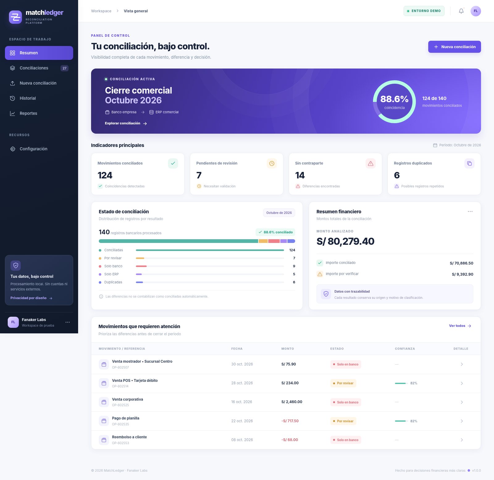
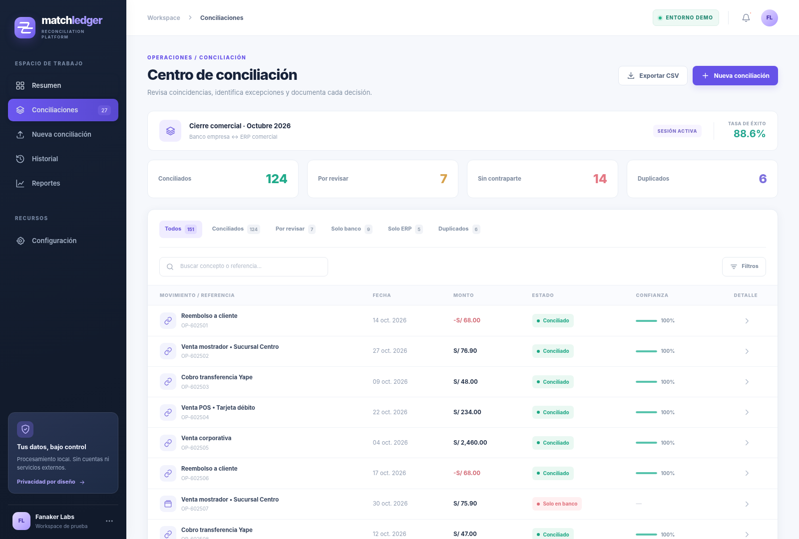
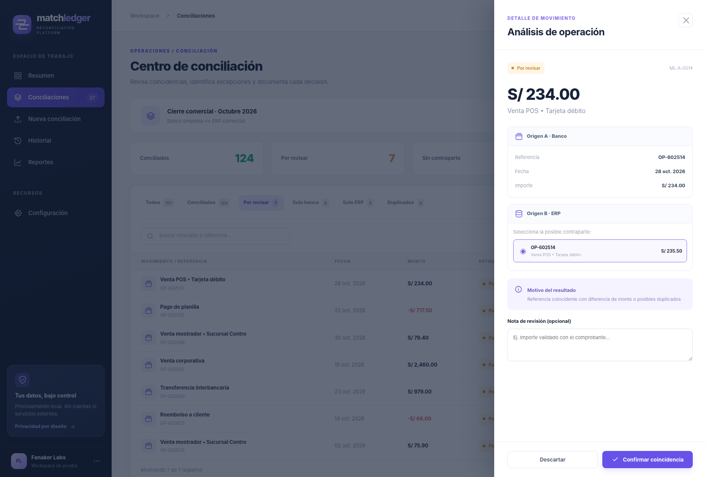
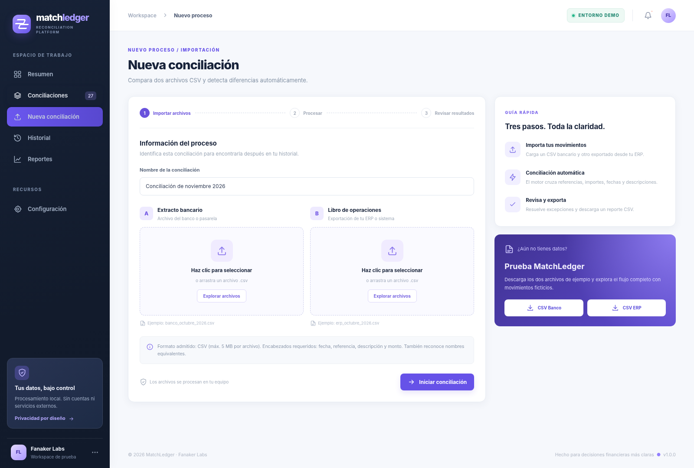
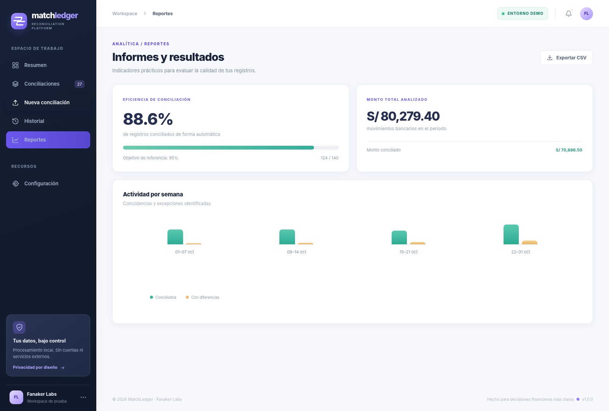
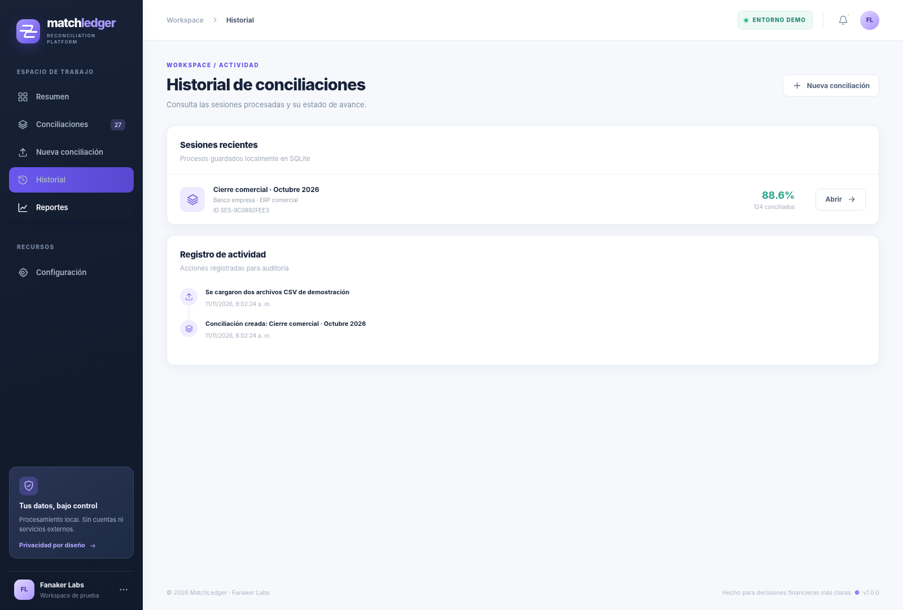

<div align="center">


# MatchLedger

### Financial reconciliation, without the spreadsheet chaos.

**Una plataforma de conciliación financiera para comparar movimientos bancarios y registros de un ERP, detectar diferencias y resolver excepciones con trazabilidad.**


</div>

---

## Vista general



MatchLedger centraliza una tarea habitual de operaciones y finanzas: verificar que cada operación registrada en dos fuentes corresponda realmente al mismo movimiento. Combina reglas de coincidencia, revisión humana, reportes descargables e historial por sesión.

> **Demo reproducible:** el proyecto incluye dos archivos CSV con movimientos completamente sintéticos. No requiere una base de datos en la nube, credenciales, servicios de terceros ni despliegue público para ejecutarse localmente.

## Recorrido por la aplicación

| Conciliaciones y filtros | Revisión manual de diferencias |
|:---:|:---:|
|  |  |
| **Importación de dos CSV** | **Analítica de resultados** |
|  |  |

<details>
<summary><strong>Ver también: historial de sesiones</strong></summary>



</details>

## Funcionalidades

- **Carga de archivos CSV:** importa extractos del banco y registros del ERP, con validación de columnas, fechas e importes.
- **Conciliación automática:** prioriza coincidencias por referencia e importe y admite coincidencias aproximadas por monto, fecha y descripción.
- **Excepciones explicables:** distingue coincidencias, diferencias por revisar, movimientos sin contraparte y registros duplicados.
- **Revisión manual:** permite confirmar una coincidencia sugerida o descartarla, con nota opcional y registro de auditoría.
- **Dashboard y reportes:** muestra tasa de conciliación, montos procesados y distribución de diferencias.
- **Historial local:** guarda las sesiones en SQLite y permite abrir resultados anteriores.
- **Exportación CSV:** descarga un informe de las operaciones junto con el motivo de clasificación.
- **Datos de demostración:** dos archivos de ejemplo preparados para reproducir el flujo sin exponer información personal.

## Tecnologías y arquitectura

| Capa | Tecnologías | Responsabilidad |
|---|---|---|
| Interfaz | **React**, JavaScript, HTML, CSS | Dashboard, tablas, filtros, importaciones, reportes y revisión |
| Backend | **Python + FastAPI** | REST API, validaciones, conciliación, resolución manual y exportación |
| Persistencia | **SQLite** | Historial de sesiones y auditoría |
| Pruebas | **pytest**, FastAPI TestClient | Reglas de importación, comparación y endpoints principales |
| CI | **GitHub Actions** | Validación automática del backend y del frontend |

Para que el proyecto se pueda abrir sin instalar dependencias de npm, el frontend utiliza una distribución React UMD incluida bajo su licencia MIT. El comando de construcción empaqueta los archivos estáticos con Node.js (sin Vite ni servicios externos). Las pantallas se basan en datos servidos por la API local, no en imágenes que sustituyan la funcionalidad.

```text
CSV del banco ──┐
                ├──> FastAPI ──> normalización ──> motor de conciliación
CSV del ERP ────┘                                  │
                                                   ├──> SQLite (sesiones y auditoría)
                                                   └──> API REST ──> interfaz React
                                                                        │
                                                 dashboard / revisión / reportes / CSV
```

Documentación adicional: [arquitectura y reglas](docs/ARCHITECTURE.md) · [API REST](docs/API.md).

## Ejecutarlo en local

**Requisitos:** Python 3.10+ y Node.js 18+ (Node solo es necesario para regenerar el frontend). No necesita Supabase, Docker, claves API ni cuentas externas.

### 1. Levantar el backend

En una terminal, desde la raíz del repositorio:

```bash
cd backend
python -m venv .venv
```

Activar el entorno virtual:

- **Windows PowerShell:** `.venv\Scripts\Activate.ps1`
- **macOS/Linux:** `source .venv/bin/activate`

Instalar dependencias y arrancar la API:

```bash
pip install -r requirements.txt
uvicorn app.main:app --reload --port 8000
```

API: **http://localhost:8000** · Documentación interactiva: **http://localhost:8000/docs**

### 2. Levantar el frontend

En otra terminal, desde la raíz:

```bash
cd frontend
npm run dev
```

Abre **http://localhost:5173**. El frontend arranca sin `npm install` porque no descarga paquetes: incluye sus recursos y genera `dist/` desde los fuentes. En Windows, si `python` no funciona, usa el comando `py`.

### 3. Probar una conciliación

En la primera ejecución aparece una sesión demo precargada. Para procesar tus propios archivos:

1. Abre **Nueva conciliación**.
2. Selecciona un CSV para el origen A y otro para el origen B (hay archivos de ejemplo en `sample-data/`).
3. Haz clic en **Iniciar conciliación**.
4. Filtra las diferencias, abre una operación por revisar y confirma o descarta una sugerencia.
5. Descarga **Exportar CSV** o consulta la sesión desde **Historial**.

**Formato mínimo de entrada** (UTF-8 o Latin-1, separador `,`, `;` o tabulador):

```csv
fecha,referencia,descripcion,monto
2026-10-08,OP-1001,Abono transferencia,125.50
2026-10-09,OP-1002,Pago proveedor,-68.00
```

También se reconocen nombres equivalentes de columnas en español e inglés. Los importes pueden usar coma decimal; el límite por archivo es **5 MB** y **3000 movimientos**.

## Verificación

```bash
# Desde backend, con dependencias instaladas
pip install -r requirements-dev.txt
pytest -q

# Desde frontend, con Node.js instalado
npm run check
```

La automatización de GitHub Actions ejecuta ambas comprobaciones en cada push y pull request. Las capturas del README corresponden a **la interfaz React renderizada con la sesión demo del motor**, no a una publicación en internet.

## Alcance y decisiones

Este sistema es un prototipo funcional de alcance educativo, no un producto bancario certificado. Usa reglas deterministas, no un modelo de IA; no incluye login multiusuario, conexiones directas con bancos ni conciliación de archivos Excel `.xlsx`. Las sugerencias ambiguas requieren validación manual. Los importes se normalizan a dos decimales y las coincidencias se determinan mediante referencias, fechas, importes y similitud de texto.

Los movimientos de `sample-data/` son **sintéticos** y su uso está reservado a demostración y pruebas.

## Autor y licencia

**Fanaker Labs** · Proyecto personal de desarrollo full stack y automatización financiera. Código bajo licencia [MIT](LICENSE).
